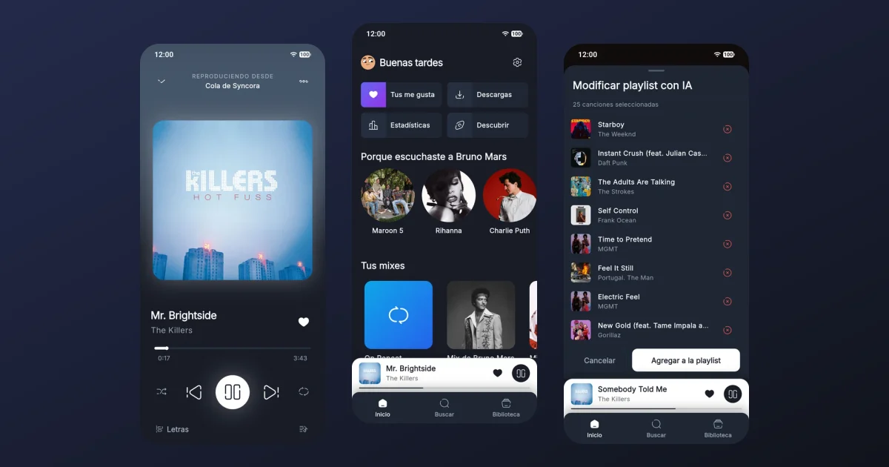
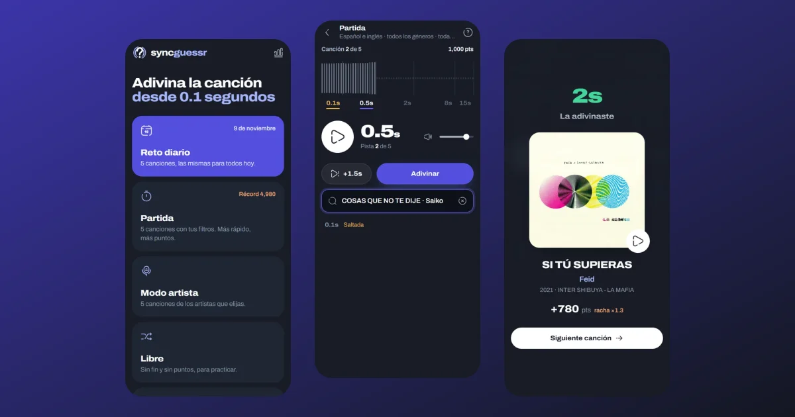
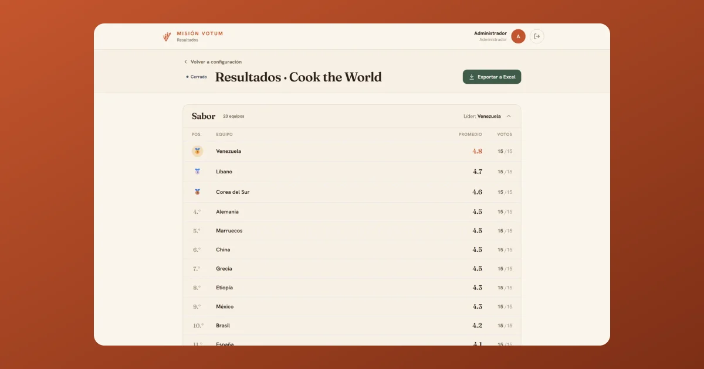
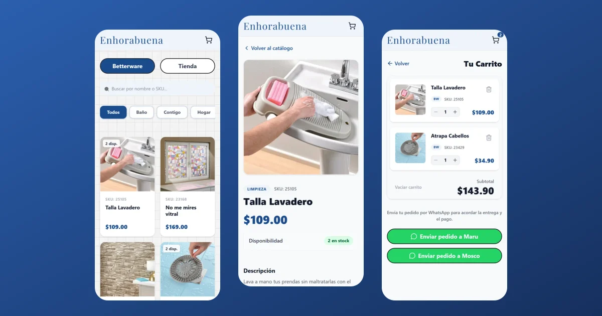
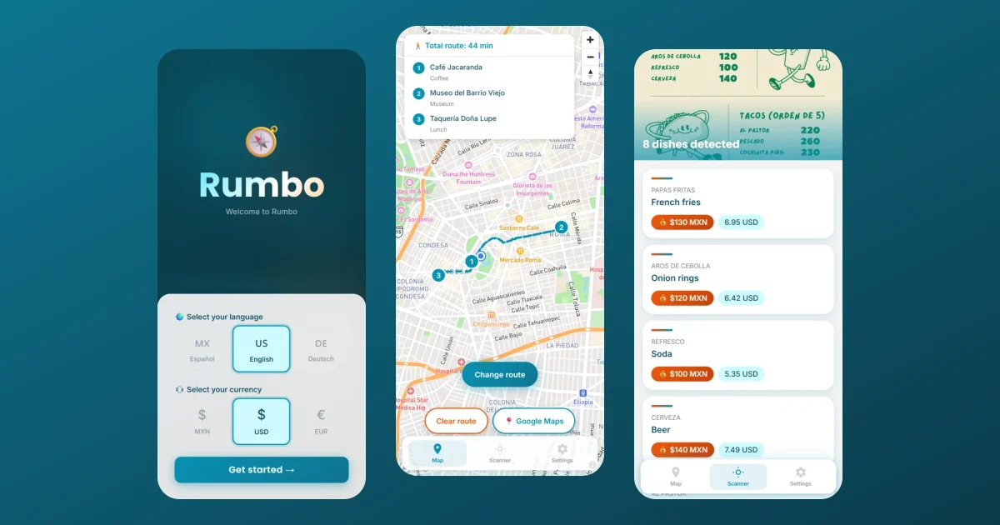
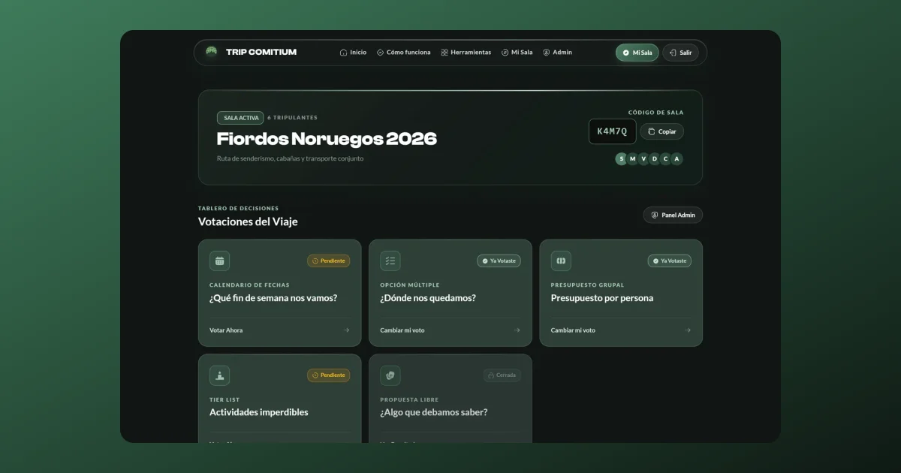
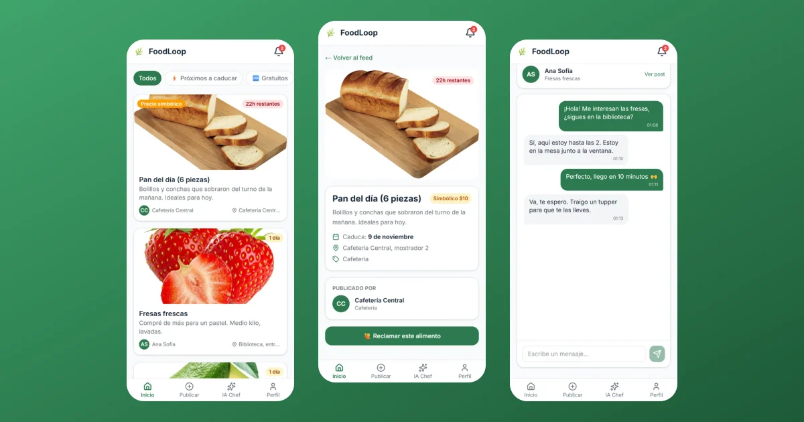
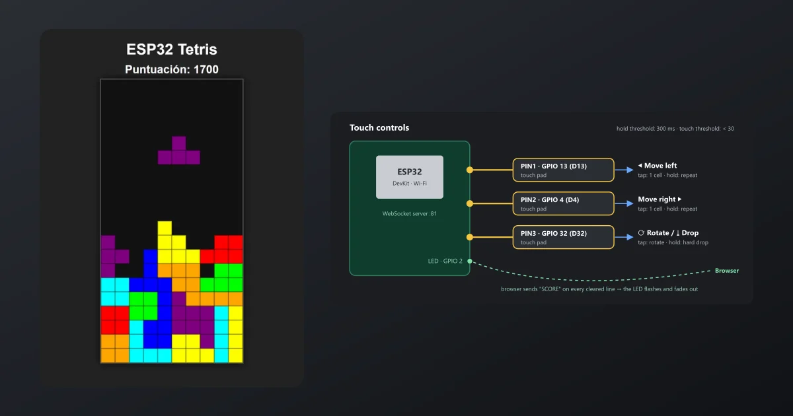

# Hi, I'm Juan Carlos 👋

**Software Engineering student at Universidad La Salle Bajío · Full Stack Developer**

I like to build things. You can see some of them below.

---

## 🚀 Featured projects

<table>
  <tr>
    <td width="50%" valign="top">
      
      <h3><a href="https://github.com/NotJcao17/syncora-player">Syncora Player</a></h3>
      Free, open-source music player for <b>Android and Windows</b>: streaming, offline downloads, synced lyrics, AI playlists, Wrapped-style stats and sync across devices. No ads, no subscriptions.
        
      <code>Flutter</code> <code>Dart</code> <code>Supabase</code> <code>Gemini</code> <code>SQLite</code>
        
      🌐 <a href="https://syncoraplayer.app">syncoraplayer.app</a> · 🖥️ <a href="https://github.com/NotJcao17/syncora-web">website repo</a>
    </td>
    <td width="50%" valign="top">
      
      <h3><a href="https://github.com/NotJcao17/syncguessr">syncguessr</a></h3>
      Guess the song from <b>0.1 seconds</b>. Daily challenge, filters by language, genre and era, artist mode, challenge links and a <b>party mode</b> over WebRTC where everyone guesses from their phone.
        
      <code>Next.js</code> <code>TypeScript</code> <code>Web Audio</code> <code>PeerJS</code> <code>Tailwind</code>
        
      🎮 <a href="https://syncguessr.vercel.app">Play it</a>
    </td>
  </tr>
  <tr>
    <td width="50%" valign="top">
      
      <h3><a href="https://github.com/NotJcao17/mision-votum">Misión Votum</a></h3>
      <b>In production</b> at Colegio Misión Montessori: judges score the cultural contests from their phones, the admin follows the progress live and exports rankings to Excel.
        
      <code>Next.js</code> <code>Prisma</code> <code>PostgreSQL</code> <code>AES-256</code> <code>ExcelJS</code>
    </td>
    <td width="50%" valign="top">
      
      <h3><a href="https://github.com/NotJcao17/enhorabuena">Enhorabuena</a></h3>
      <b>In production</b> for a Betterware reseller: barcode scanning with the phone, inventory by location, sales history and a public catalog synced daily with checkout over WhatsApp.
        
      <code>Next.js</code> <code>Prisma</code> <code>NextAuth</code> <code>Cloudinary</code> <code>PWA</code>
        
      🛍️ <a href="https://enhorabuena.vercel.app">Live catalog</a>
    </td>
  </tr>
  <tr>
    <td width="50%" valign="top">
      
      <h3><a href="https://github.com/NotJcao17/rumbo">Rumbo</a></h3>
      <b>Talent Land 2026</b> hackathon. Connects World Cup visitors with Mexico City's local businesses: walking routes, prices in your currency and a menu scanner that translates with AI.
        
      <code>Next.js</code> <code>Mapbox</code> <code>PostGIS</code> <code>Gemini</code> <code>next-intl</code>
    </td>
    <td width="50%" valign="top">
      
      <h3><a href="https://github.com/NotJcao17/trip-comitium-frontend">Trip Comitium</a></h3>
      Plan a group trip by voting instead of arguing in the chat: date heatmaps, budget sliders, tier lists and polls in rooms you join with a five-character code.
        
      <code>Angular</code> <code>Express</code> <code>MySQL</code> <code>JWT</code>
        
      ✈️ <a href="https://trip-comitium.netlify.app">Live demo</a> · ⚙️ <a href="https://github.com/NotJcao17/trip-comitium-backend">backend repo</a>
    </td>
  </tr>
  <tr>
    <td width="50%" valign="top">
      
      <h3><a href="https://github.com/NotJcao17/foodloop">FoodLoop</a></h3>
      <b>DevWeek 26</b> hackathon. A campus PWA to share food before it expires: claim it, coordinate the pickup in a real-time chat and ask the AI chef for recipes.
        
      <code>Next.js</code> <code>Supabase Realtime</code> <code>Gemini</code> <code>PWA</code>
    </td>
    <td width="50%" valign="top">
      
      <h3><a href="https://github.com/NotJcao17/tetris">ESP32 Tetris</a></h3>
      IoT project: a falling-blocks game in the browser controlled with the <b>capacitive touch pins</b> of an ESP32 over WebSockets. The board's LED flashes on every cleared line.
        
      <code>ESP32</code> <code>C++</code> <code>PlatformIO</code> <code>WebSockets</code> <code>Canvas</code>
    </td>
  </tr>
</table>

---

## 🛠️ Tech stack

**Languages**

**Frontend and mobile**

**Backend and data**

**Cloud, AI and tools**

---

## 📫 Let's talk

I'm interested in **software architecture** and **full stack development**. If you want to talk about
a project, an internship or something I built, reach me on
[LinkedIn](https://www.linkedin.com/in/juancarlos-on/) or at
[orozcojuanc27@gmail.com](mailto:orozcojuanc27@gmail.com).
